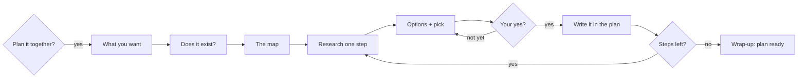

# Together We Plan

**Plan anything new with your AI, one decision at a time, in plain words, before anything
gets built.**

Together We Plan is a skill for AI agents. It turns your AI from a helper that rushes to
build into a partner that plans with you first. You make every decision. Your AI does the
research and explains each choice in words you understand.

It works with Claude Code, Gemini CLI, GitHub Copilot, Claude.ai and other AI agents that
support the open [Agent Skills](https://github.com/agentskills/agentskills) format.

## What is a skill?

A skill is a short set of instructions your AI agent reads when it needs them, like a
recipe. This one is a single file, [`SKILL.md`](skills/together-we-plan/SKILL.md). There is
no app to install, no code to run and no account to make.

## Who is it for?

- **People who build with AI but don't write code**: founders, small business owners,
  freelancers, makers.
- **Anyone starting something new**: an app, a website, an online shop, an automation, a
  new way of working, or a way out of a problem they understand but don't know how to fix.
- **Anyone who wants to understand each choice**, instead of approving a finished plan they
  can't judge.

You don't need to be technical. The skill assumes you aren't, explains every new word, and
never asks you to pick a tool you don't know.

## The problem it solves

Ask an AI to build something and it usually jumps straight in. On its own, it tends to:

- **guess what you want** instead of asking;
- **design everything alone, in one go**;
- **build from scratch** when a ready-made tool would already do the job;
- **answer from memory**, even though prices, limits and tools change all the time;
- **offer one way**, or a long list with no advice;
- **show everything at once**, so you can't judge step 4 while step 3 is still open;
- **use words you don't know**;
- **take silence, or "what next?", as a yes**;
- **forget** what you decided once the chat ends.

Usually you find out at the end, after the time and money are spent.

## How it works

**It asks first.** When your request looks like it needs a plan, your AI suggests planning
it together and waits for your yes. To start straight away, type `/together-we-plan` or ask
for it by name.

Then:

1. **What do you want to end up with?** A few short questions, each with the AI's own
   guess, so most answers are just "yes". Big picture only: no buttons or colours yet. Then
   it sums it up in one line, with what it won't do and how you'll check it works, and moves
   on only when you agree.
2. **Does this already exist?** It checks whether a ready-made tool or service already does
   it, and shows you the links.
3. **The map.** It splits the work into steps, checked against how similar products are
   built, and shows them as a simple table. You agree on the map before anything else.
4. **One step at a time.** For each step it looks up how others do it, then shows your
   options side by side in terms you can feel: cost, effort, what could break, risk to your
   money or data, and what it costs to grow. It tells you which one it would pick, why, and
   what's wrong with that pick.
5. **Your yes decides.** Only a clear yes ("yes", "ok", 👍) closes a step. "I guess…" doesn't.
6. **Wrap-up.** It suggests what a later version could add, checks the plan for gaps, and
   marks it ready.



## What you get

**A written plan, in your own language.** It's saved as a file in your project
(`docs/plans/<topic>.md`) or in a folder you choose, and it holds only what you said yes to.
If your project uses git, the finished plan is also committed there. A short example:

```markdown
# Custom cake orders — plan
Status: step 2 of 8 open

## Output
- In one line: customers ask for a cake from their phone, the baker sends a price,
  the customer pays a deposit to confirm.
- Won't do: take the full payment online; delivery.
- Limits: at most $30 a month; never PayPal.

## Map
| # | Step              | Status |
|---|-------------------|--------|
| 1 | The order form    | ✅     |
| 2 | Pickup dates      | ⏳     |
| 3 | Sending the price | ⏳     |

## Decisions
✅ Step 1 — A short order form with 9 questions.
   Why, its limits, and links to what was checked.
```

**Come back any time.** Close the chat. Tomorrow, in the same folder, say *"continue the
cake orders plan"* and it picks up where you stopped. In a chat that can't keep files, it
gives you the plan as one block to save and paste back in.

## Its promises

- **Nothing gets built, bought or signed up for** until the plan is done or you say start.
  The one exception is a free sign-up you agree to, just to check a fact.
- **No guessed prices or limits.** Every fact that can change comes with a link. If it
  can't check something, it says so.
- **Nothing is decided without your clear yes.**
- **Nothing is dropped quietly.** If something has to be cut or put off, it tells you and
  writes it down.
- **Plain words, in your language.** Technical terms are explained the first time they come
  up.

## When not to use it

- Finding out **why something broke**. That's debugging, not planning.
- A question with **one factual answer**.
- A **small change** where the way to do it is already clear.
- Work that **already has an agreed plan**.

## Install

Make a folder named `together-we-plan` and put
[`SKILL.md`](skills/together-we-plan/SKILL.md) inside it. Where the folder goes depends on
your AI agent:

| Agent | For all your projects | For one project |
|---|---|---|
| [Claude Code](https://code.claude.com/docs/en/skills) | `~/.claude/skills/together-we-plan/` | `.claude/skills/together-we-plan/` |
| [Gemini CLI](https://github.com/google-gemini/gemini-cli/blob/main/docs/cli/skills.md) | `~/.gemini/skills/together-we-plan/` or `~/.agents/skills/together-we-plan/` | `.gemini/skills/together-we-plan/` or `.agents/skills/together-we-plan/` |
| [GitHub Copilot](https://github.com/github/docs/blob/main/content/copilot/concepts/agents/about-agent-skills.md) | `~/.copilot/skills/together-we-plan/` or `~/.agents/skills/together-we-plan/` | `.github/skills/together-we-plan/` or `.agents/skills/together-we-plan/` |
| Claude.ai | Upload it as a custom skill. | |
| Other agents | Check where your agent loads skills from. Many read `.agents/skills/`. | |

To download it, open [`SKILL.md`](skills/together-we-plan/SKILL.md) and click the download
button (**Download raw file**) at the top right of the file.

## What you need

- An AI agent that supports Agent Skills.
- Web search turned on in that agent, for the research and links. Without it the plan
  still works, but it tells you what it couldn't check.

## Questions

**Do I need to know how to code?** No. That's who it's built for.

**Can I let it decide?** Yes. Say "go with yours" to take its pick for a step. Or say "pick
the rest and start": it shows its pick for every open step, with the risks, and asks you
once.

**Can I stop halfway?** Yes. The plan is saved and marked paused. Pick it up whenever you
like.

**Will it build the thing too?** No, it only plans. Once the plan is ready, your AI can
build from it, step by step.

## License

MIT. See [LICENSE](LICENSE).
